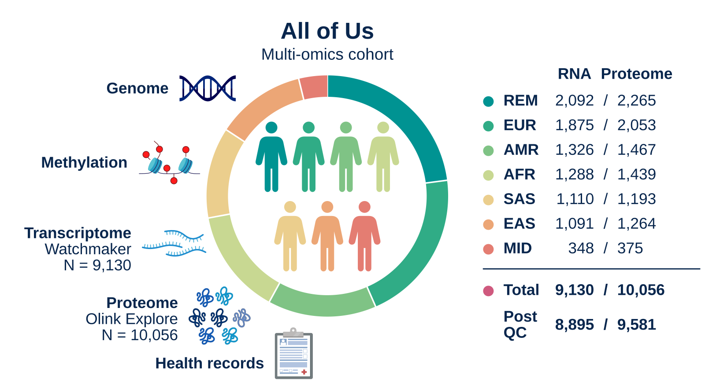
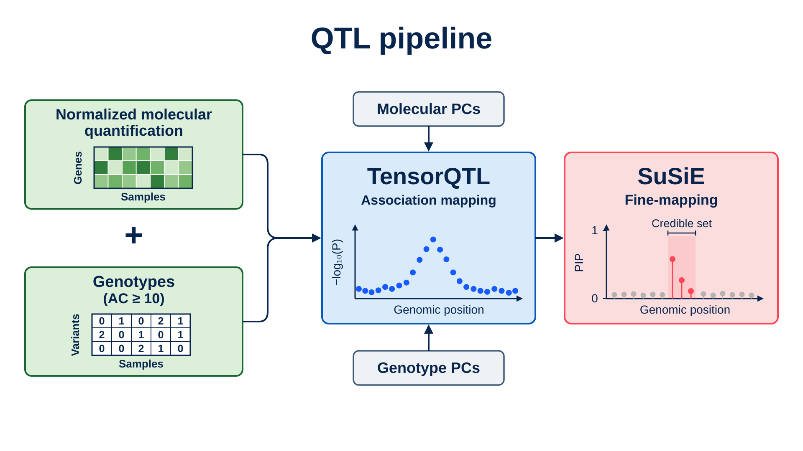

# AoU Multi-omics Analysis

This organization hosts pipelines and analysis tools for the [All of Us Research Program](https://www.researchallofus.org) multi-omic analyses. For productionized versions see https://github.com/broadinstitute/WARP

**[Multi-omics in the All Of Us Research Program expands mapping genetic mechanisms in health and disease](https://www.medrxiv.org/content/10.64898/2026.10.29.26366507v1)**  
Padhi et al. · medRxiv · November 2026

For analysis code, see [QTL Figure code](https://github.com/AoU-Multiomics-Analysis/QTLFigureCode)

## Study cohort

The manuscript reports a cohort of **10,056 participants** with whole-genome sequencing and plasma proteomics. Total RNA-seq data were available for **9,130 participants**.

| Molecular data | Participants with data | Participants retained for QTL mapping after QC |
|---|---:|---:|
| Whole-blood total RNA-seq | 9,130 | 8,895 |
| Plasma proteomics, measured with Olink Explore HT | 10,056 | 9,581 |

The cohort includes AFR, AMR, EAS, EUR, MID, and SAS genetic similarity groups. The REM group includes participants outside these reference groups and participants with admixed ancestry.

## Pipelines for manuscript analyses

The study maps expression, splicing, and protein quantitative trait loci: **eQTLs**, **sQTLs**, and **pQTLs**. The table links each analysis stage to its current repository.

| Analysis stage | Repository | Purpose |
|---|---|---|
| Genotype preparation | [MTtoVCF](https://github.com/AoU-Multiomics-Analysis/MTtoVCF) | Filter AoU Hail MatrixTables, add variant annotations, and export genotype files. |
| Molecular phenotype and covariate preparation | [prepare_QTL](https://github.com/AoU-Multiomics-Analysis/prepare_QTL) | Filter and normalize expression, splicing, and protein measurements. Prepare QTL inputs and principal-component covariates. |
| *cis*-QTL mapping | [tensorQTL_cis_permutations](https://github.com/AoU-Multiomics-Analysis/tensorQTL_cis_permutations) | Run tensorQTL permutation tests in the pooled cohort and within genetic similarity groups. |
| Fine-mapping and result aggregation | [susieR](https://github.com/AoU-Multiomics-Analysis/susieR) | Fine-map significant *cis*-QTLs with SuSiE. Combine results and annotate credible sets and variants. |
| Ancestry enrichment | [susieR](https://github.com/AoU-Multiomics-Analysis/susieR) | Test allele-frequency enrichment across genetic similarity groups for variants with high posterior support. |
| Allelic fold change and regulatory burden | [QuantifyQTLBurden](https://github.com/AoU-Multiomics-Analysis/QuantifyQTLBurden) | Estimate allelic fold change and combine variant effects to quantify regulatory burden for each participant and gene. |
| QTL–GWAS colocalization | [FastEnlocTrait](https://github.com/AoU-Multiomics-Analysis/FastEnlocTrait) | Run fastENLOC and CLPP analyses to connect molecular QTL signals with complex traits. |
| Transcriptome-wide association studies | [TWAS](https://github.com/AoU-Multiomics-Analysis/TWAS) | Combine SuSiE weights with GWAS summary statistics. Test rare-variant contributions conditional on common-variant contributions. |

## Other analysis steps described in the manuscript

For processing of raw data please see: https://broadinstitute.github.io/warp/docs/All_of_Us/RNA_Seq_QTL/overview
- **RNA-seq processing:** Picard read extraction, STAR alignment with WASP filtering, duplicate marking, and RNA-SeQC 2 quantification.
- **Splicing quantification:** regtools splice-junction extraction and LeafCutter intron clustering.

See the manuscript Methods for analysis settings and statistical thresholds.

## Workflows and containers

The organization provides [WDL](https://github.com/openwdl/wdl) workflows for Terra/Cromwell, with supporting R and Python scripts.

Published container images are available under [Packages](https://github.com/orgs/AoU-Multiomics-Analysis/packages). See each repository for workflow inputs, outputs, dependencies, and execution instructions.
